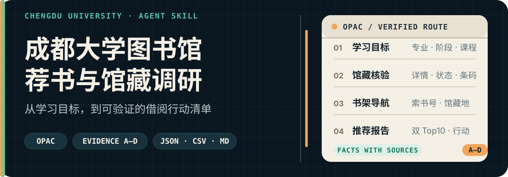
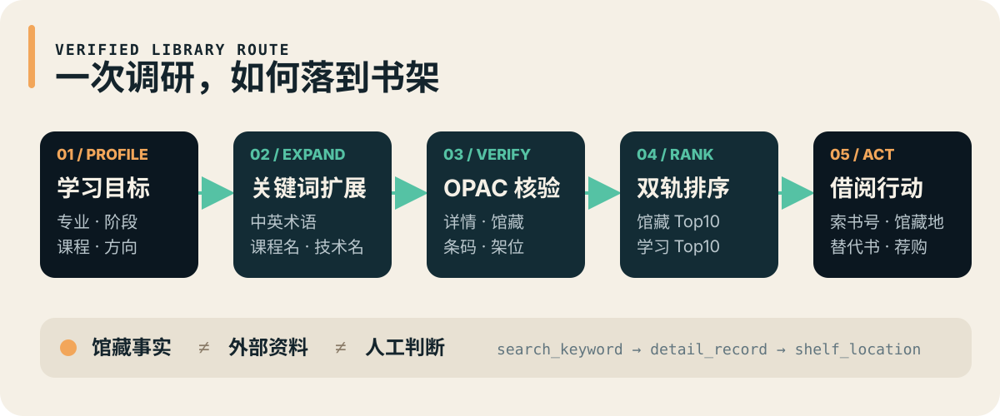

<p align="center">
  
</p>

<p align="center">
  <a href="#先跑通一次">快速开始</a> ·
  <a href="#它如何工作">工作流</a> ·
  <a href="#输出什么">输出格式</a> ·
  <a href="#可信度与安全边界">可信边界</a> ·
  <a href="#项目结构">项目结构</a>
</p>

<p align="center">
  
  
  
  
</p>

`cdu-library-book-survey` 是一个面向成都大学学生的 **Agent-neutral Skill**。它把专业、课程、考研、科研或职业目标，转化为可以执行的馆藏调研：

```text
我该学什么
→ 馆里哪些书真正值得借
→ 现在能不能借
→ 去哪里找
→ 馆藏还缺什么
→ 明天到馆后的行动顺序
```

它不是一次性提示词，也不只是一个爬取脚本。仓库同时提供 Agent 规则、OPAC 采集脚本、排序与防幻觉规范、学习路线和报告模板。

## 你会得到什么

| 你关心的问题 | Skill 给出的结果 |
|---|---|
| 哪些书值得借？ | 馆藏推荐 Top10，并说明解决的问题、适合阶段和推荐证据 |
| 哪些书最值得学？ | 独立的学习价值 Top10，不把“馆里有”误当成“最值得学” |
| 现在能借吗？ | 馆藏状态、条码与核验时间；无法实时确认时明确标记 |
| 去哪里找？ | 索书号、馆藏地，以及可获取时的楼层/区/排/面/列/层 |
| 怎么安排学习？ | 书籍到课程、能力与未来方向的路线映射 |
| 馆藏够不够？ | 已覆盖、部分覆盖、明显不足的模块及校外补充建议 |
| 明天怎么借？ | 按优先级排列的到馆行动清单与替代方案 |

核心输出约束：

```text
馆藏推荐 = 书目事实 + 可借状态 + 馆藏位置 + 推荐理由 + 证据来源
学习价值推荐 = 课程/能力匹配 + 阅读成本 + 馆藏关系 + 建议阶段
```

## 先跑通一次

### 方式一：把仓库交给 Agent

把下面这段话发给支持读取 GitHub 仓库的 Agent：

```text
请读取并使用这个 Skill：
https://github.com/A7m0spHere/cdu-library-book-survey

我是成都大学【专业】【年级】学生，
正在学习【课程/主题】，目标是【课程/考研/科研/职业方向】。
请输出 normal 深度报告，并说明馆藏事实、外部资料和人工判断的来源。
```

不同 Agent 可使用对应入口：

| 使用环境 | 建议入口 |
|---|---|
| Codex / Cursor / Gemini CLI | [`AGENTS.md`](./AGENTS.md) |
| ChatGPT Skill 或通用 Skill 加载器 | [`SKILL.md`](./SKILL.md) |
| Claude Code | [`CLAUDE.md`](./CLAUDE.md) |
| 任意可复制提示词的 AI | [`prompt.md`](./prompt.md) |

### 方式二：运行 OPAC 采集脚本

脚本仅使用 Python 标准库，负责采集检索结果、详情页、馆藏状态和架位信息。

```bash
git clone https://github.com/A7m0spHere/cdu-library-book-survey.git
cd cdu-library-book-survey
```

创建 `request.json`：

```json
{
  "profile": {
    "school": "成都大学",
    "major": "你的专业",
    "stage": "年级或学习阶段",
    "goal": "学习或研究目标",
    "purpose": "课程学习 / 考研 / 科研入门 / 兴趣拓展 / 职业技能",
    "network": "校园网 / 学校 VPN / 校外未连接 VPN / 未知",
    "output_depth": "normal"
  },
  "keywords": ["关键词1", "关键词2", "关键词3"],
  "max_results_per_keyword": 50,
  "include_shelf_locations": true,
  "use_cache": true
}
```

运行：

```bash
python scripts/opac_survey.py --input request.json --output survey.json --format json
```

也可以输出 CSV 或 Markdown：

```bash
python scripts/opac_survey.py --input request.json --output survey.csv --format csv
python scripts/opac_survey.py --input request.json --output survey.md --format md
```

> 脚本负责收集证据；推荐排序、学习路线、能力映射和最终报告由 Agent 按 `references/` 中的规则完成。

## 它如何工作

<p align="center">
  
</p>

1. **理解需求**：记录专业、阶段、目标、用途和网络状态。
2. **建立路线**：从课程与能力关系出发，决定“现在读”和“后续读”。
3. **扩展关键词**：同时使用中文、英文、课程名、同义词和技术名。
4. **核验 OPAC**：按出版日期检索，检查详情、主题、摘要、馆藏、条码和状态。
5. **解析位置**：优先给出精确书架位置；否则给出馆藏地和索书号。
6. **合并版本**：比较同名教材的新旧版，排除习题集、考试辅导和低相关记录。
7. **双轨排序**：分别生成馆藏推荐和学习价值推荐。
8. **形成行动**：补充能力映射、馆藏缺口、校外书和到馆借阅顺序。

完整流程见 [`references/workflow.md`](./references/workflow.md)。

## 为什么不是普通荐书 Prompt

- **先核验，再推荐**：不根据书名直接下结论，优先检查详情页、馆藏状态和位置。
- **两套 Top10**：馆藏可用性与长期学习价值分开排序。
- **证据分层**：馆藏事实、外部资料和人工判断不能混写。
- **考虑阅读成本**：避免把正确但暂时读不动的书塞进入门清单。
- **合并版本**：同一教材的新旧版不会重复占据推荐位。
- **允许手动辅助**：OPAC 无法访问时，可接收截图、复制文本或导出结果继续分析。
- **限制外部书数量**：校外补充最多 8 本，每本必须说明补足了什么馆藏短板。

## 输出什么

### 三种深度

| 模式 | 适用场景 | 核心输出 |
|---|---|---|
| `brief` | 快速借书 | 馆藏 Top10、到馆行动清单 |
| `normal` | 默认调研 | 馆藏 Top10、学习 Top10、缺口分析、行动清单 |
| `deep` | 课程/科研规划 | 学习路线、课程与能力映射、馆藏分析、校外补充、荐购建议、来源日志 |

### 报告骨架

默认报告会包含：

- 用户需求摘要；
- 学习路线与能力映射；
- 馆藏推荐 Top10；
- 学习价值 Top10；
- 最容易马上找到、适合馆内查阅的书；
- 校外更优补充与馆藏缺口；
- “如果只能借/买 5 本”；
- “明天去图书馆该怎么借”；
- Source Log。

完整字段见 [`references/report-template.md`](./references/report-template.md)。

## 可信度与安全边界

### 证据标签

| 标签 | 使用场景 |
|---|---|
| `[未核验]` | OPAC 信息尚未核验 |
| `[缓存数据]` | 使用了缓存记录 |
| `[外部资料]` | 来自出版机构或其他外部来源 |
| `[人工判断]` | 来自路线、课程或学习价值判断 |
| `[未实时核验]` | 无法确认当前借阅状态 |

推荐置信度从 A 到 D：A 表示详情、馆藏状态与位置均已核验；无法实时访问 OPAC 时不会使用 A。

### 网络前置条件

成都大学 OPAC 可能需要：

1. 成都大学校园网；
2. 学校 VPN；
3. 用户提供搜索结果、详情页或图书定位截图。

OPAC 地址：<http://libopac.cdu.edu.cn/opac/search_adv.php#/index>

### 不会执行的操作

- 不登录个人图书馆账号；
- 不查询个人借阅记录；
- 不绕过验证码、登录或访问限制；
- 不高频访问 OPAC；
- 不把未核验数据写成馆藏事实；
- 不在未经明确请求时预约、续借或提交荐购。

<details>
<summary><strong>缓存有效期</strong></summary>

| 数据类型 | 有效期 |
|---|---:|
| 书目元数据 | 30 天 |
| 图书定位信息 | 30 天 |
| 关键词检索结果 | 30 天 |
| 馆藏/可借状态 | 3 天 |

使用缓存且无法实时复核时，输出必须同时标记 `[缓存数据]` 和 `[未实时核验]`。

</details>

## 项目结构

```text
cdu-library-book-survey/
├── README.md
├── AGENTS.md
├── SKILL.md
├── CLAUDE.md
├── prompt.md
├── assets/readme/
│   ├── hero.svg
│   └── workflow.svg
├── scripts/
│   └── opac_survey.py
├── cache/
└── references/
    ├── workflow.md
    ├── ranking-rules.md
    ├── keyword-expansion.md
    ├── confidence-rules.md
    ├── reading-cost-rules.md
    ├── route-templates.md
    ├── capability-mapping.md
    ├── gap-analysis.md
    ├── hallucination-prevention.md
    ├── recommendation-rules.md
    └── report-template.md
```

规则入口：

- [排序、版本合并与校外书规则](./references/ranking-rules.md)
- [关键词扩展](./references/keyword-expansion.md)
- [学习路线模板](./references/route-templates.md)
- [能力映射](./references/capability-mapping.md)
- [置信度规则](./references/confidence-rules.md)
- [阅读成本](./references/reading-cost-rules.md)
- [馆藏缺口分析](./references/gap-analysis.md)
- [防幻觉规则](./references/hallucination-prevention.md)

## 当前限制

- OPAC 是否可访问取决于校园网络、VPN 和站点状态。
- 精确架位不可用时，只能提供馆藏地和索书号，并标记“需到馆内按索书号查找”。
- 脚本输出的是采集结果，不代替 Agent 的学术判断与最终推荐。
- 本仓库目前尚未提供 `LICENSE` 文件；公开复用前应先向维护者确认许可范围。
